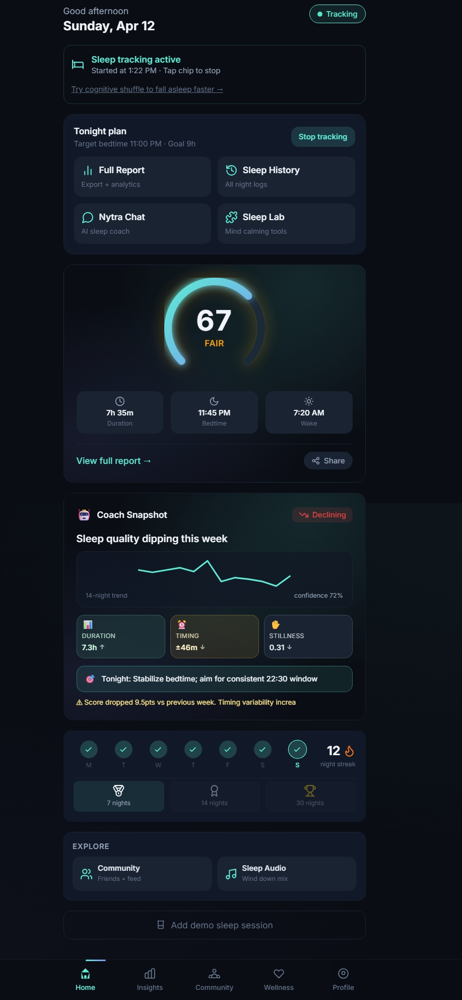
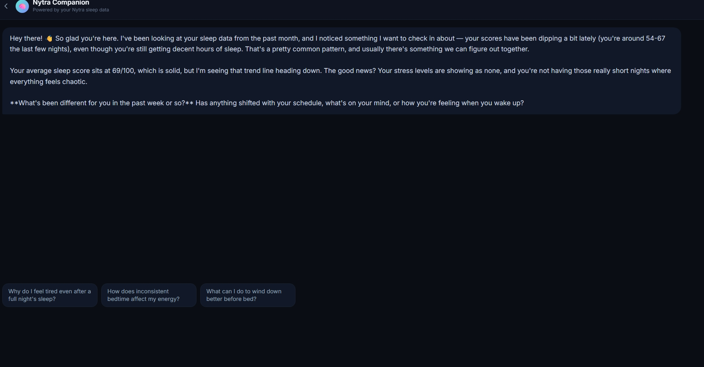
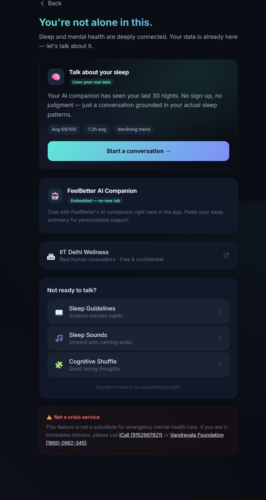
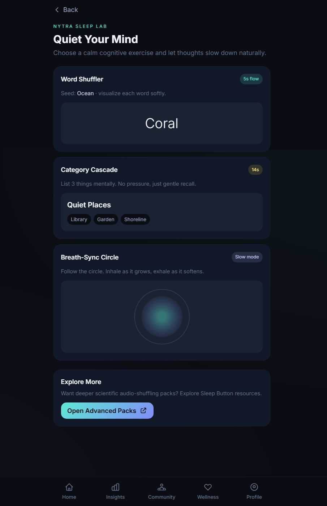
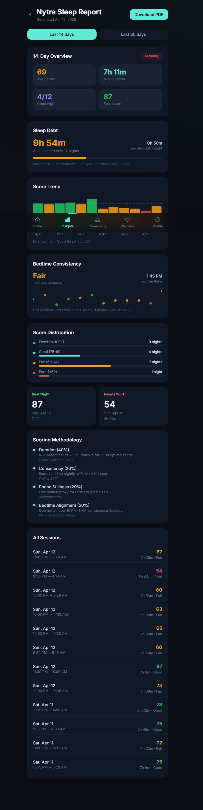
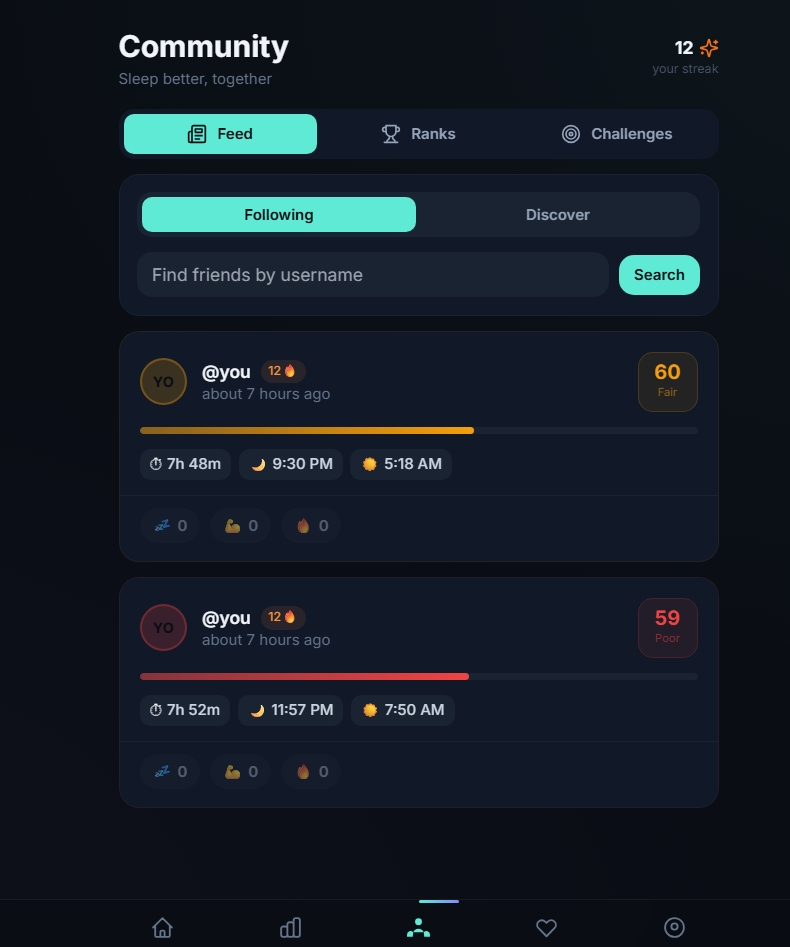
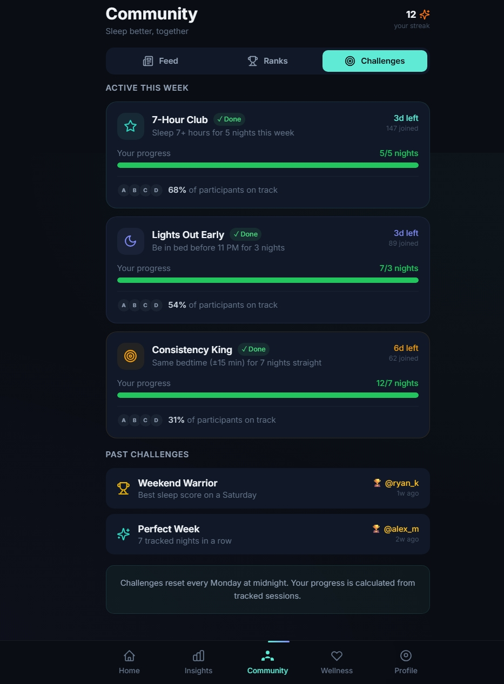
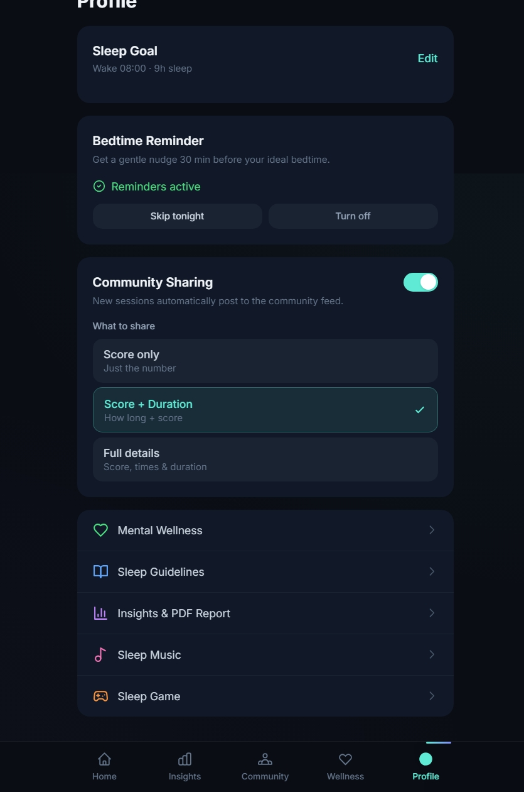
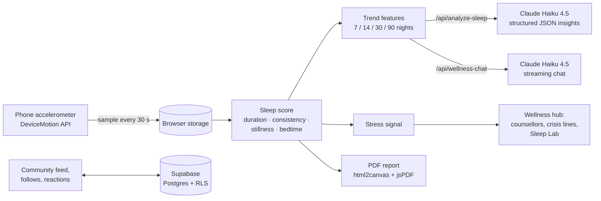

<div align="center">

# Nytra: AI Sleep Coach for Mental Wellness

**Sleep as the first line of defence for mental health.**

An AI sleep coach that turns your phone's motion sensor into nightly sleep data, explains your trends in plain language with Claude, and hands you off to a human professional when it matters.

[](https://nextjs.org/)
[](https://www.typescriptlang.org/)
[](https://tailwindcss.com/)
[](https://supabase.com/)
[](https://www.anthropic.com/)
[](LICENSE)

🏆 Built at the **[Anthropic Hackathon @ IIT Delhi](https://anthropic-hackathon-iitd.devpost.com/)** · Track 2: Neuroscience & Mental Health

[**Devpost**](https://devpost.com/software/brainwave-nrx8f4) · [**Demo video**](https://www.youtube.com/watch?v=90obHKcMEqI)



</div>

---

## Why Nytra

Sleep is usually the first thing to break when someone is heading toward burnout, anxiety or depression. Therapy is expensive, hard to access and carries stigma, but a phone is on the nightstand every night.

Nytra starts there. It tracks sleep passively, explains what the numbers mean, gives you something calming to do at 3 AM, and when the pattern looks worrying, it points you to real people with a report you can take to them.

> **What AI can and can't do here.** Nytra's AI spots patterns, offers evidence-based sleep hygiene and CBT-I techniques, and is available at any hour. It does not diagnose, never suggests medication, and is explicitly not a crisis service. The app surfaces Indian crisis lines (iCall, Vandrevala Foundation) and free IIT Delhi counselling, and the PDF report exists so users can walk into a doctor's office with real data.

## Features

| | |
|---|---|
| 🌙 **Motion-based sleep tracking** | Uses the browser's `DeviceMotion` accelerometer API, sampled every 30 s, to estimate how still the phone stayed overnight. Works on iOS Safari (with permission) and Android Chrome. |
| 📊 **Research-backed sleep score** | A 0–100 score built from sleep-science guidelines (see [Sleep score](#sleep-score)). |
| 🤖 **AI Coach Snapshot** | Claude reads 7-, 14-, 30- and 90-night trend features and returns a headline, three metric chips and one concrete action for tonight. |
| 💬 **Nytra Chat** | A streaming, empathetic sleep companion grounded in your last 30 nights, with clinical guardrails built into the system prompt. |
| 🧩 **Sleep Lab** | CBT-inspired wind-down exercises to break rumination: Word Shuffler (cognitive shuffling), Category Cascade, and a Breath-Sync Circle. |
| 🫂 **Wellness hub** | A stress signal from your sleep trends, links to FeelBetter's AI companion and IIT Delhi counsellors, sleep guidelines, and Spotify sleep playlists. |
| 🧾 **Clinical handoff report** | A 14- or 30-day report covering sleep debt, bedtime consistency, score distribution and every session, exported as a PDF **entirely in the browser**. |
| 👥 **Community** | Follow friends, share nights with privacy levels (score only, score + duration, or full details), react with emoji, and join weekly challenges. |
| ⏰ **Bedtime reminders** | A browser notification 30 minutes before your target bedtime. |

## Screenshots

<table>
  <tr>
    <td align="center"><br /><b>Nytra Chat</b>: opens with your own data</td>
  </tr>
</table>

<table>
  <tr>
    <td align="center" width="33%"><br /><b>Wellness hub</b></td>
    <td align="center" width="33%"><br /><b>Sleep Lab</b></td>
    <td align="center" width="33%"><br /><b>Clinical report</b></td>
  </tr>
  <tr>
    <td align="center"><br /><b>Community feed</b></td>
    <td align="center"><br /><b>Weekly challenges</b></td>
    <td align="center"><br /><b>Privacy controls</b></td>
  </tr>
</table>

## How it works



### Sleep score

`src/lib/scorer.ts` scores each night out of 100:

| Component | Points | Basis |
|---|---:|---|
| **Duration** | 40 | 7–9 h is optimal (NSF, Hirshkowitz et al. 2015). Short sleep is penalised, and so is oversleeping past 9 h (Cappuccio et al. 2010). |
| **Consistency** | 20 | How close tonight's bedtime is to last night's (circadian stability), with correct handling of midnight wrap-around. |
| **Phone stillness** | 20 | Mean accelerometer magnitude across the night. Less motion suggests the phone stayed untouched. |
| **Bedtime alignment** | 20 | Full marks for a 10 PM–1 AM bedtime, the melatonin-onset window (Monk et al. 1997; AASM). |

### AI layer

Both endpoints run server-side on Next.js route handlers, so the Anthropic key never reaches the browser.

- **`/api/analyze-sleep`** turns raw sessions into a compact feature payload: window averages, bedtime and wake-time variability, week-over-week deltas, and weekday versus weekend. It asks Claude for **strict JSON** and then validates, clamps and normalises every field before the UI renders it. Results are cached client-side by data hash, so the same data never triggers a second call.
- **`/api/wellness-chat`** streams responses over server-sent events. The system prompt injects the user's 30-day context and enforces guardrails: no diagnosis, no medication advice, no claims about sleep stages (the app measures motion, not EEG), and a gentle referral to crisis lines if distress or self-harm comes up.

### Stress signal

`src/lib/stressDetector.ts` needs at least 5 nights in the last 30 days. It classifies the trend as **High** (average score below 45), **Moderate** (45–55 with under 6.5 h average), **Mild** (55–65, or 3 or more nights under 6 h in two weeks), or **None**. Higher tiers surface the wellness and counselling options more prominently.

### Privacy by design

- Sleep sessions and motion samples stay in the **browser's local storage**.
- The PDF report is rendered **on the device**, so health logs never touch a third-party server.
- Community data in Supabase is protected by **row-level security**. You can read your own sessions, and others' only if they marked them as shared and you follow them.

## Tech stack

| Layer | Tools |
|---|---|
| Frontend | Next.js 14 (App Router), React 18, TypeScript, Tailwind CSS, Lucide icons, date-fns |
| AI | Anthropic SDK with Claude Haiku 4.5, plus streaming over server-sent events |
| Backend and data | Supabase (Postgres, Auth, row-level security), with the browser's local storage for on-device data |
| Device APIs | DeviceMotion, Notifications, Clipboard |
| Reports | html2canvas and jsPDF |
| Integrations | Spotify (PKCE OAuth and embeds), FeelBetter companion |
| Hosting | Vercel |

## Getting started

### Prerequisites

- Node.js 18+
- An [Anthropic API key](https://console.anthropic.com/)
- A [Supabase](https://supabase.com/) project, needed for the community features
- Optionally, a [Spotify app](https://developer.spotify.com/dashboard) client ID, with `http://localhost:3000/music` as a redirect URI

### Run locally

```bash
git clone https://github.com/Vedant-Singhal/nytra-ai-sleep-coach.git
cd nytra-ai-sleep-coach
npm install
cp .env.local.example .env.local   # then fill in your keys
npm run dev
```

Open [http://localhost:3000](http://localhost:3000). To try the app without sleeping on it, tap **Add demo sleep session** on the home screen to generate sample nights.

### Set up the database

In your Supabase project, open the **SQL Editor**, paste [`supabase/schema.sql`](supabase/schema.sql), and run it. This creates the `profiles`, `follows`, `sleep_sessions` and `kudos` tables along with their row-level security policies and indexes.

### Environment variables

| Variable | Required | Purpose |
|---|---|---|
| `ANTHROPIC_API_KEY` | Yes | Coach Snapshot and Nytra Chat (server-side only) |
| `NEXT_PUBLIC_SUPABASE_URL` | Yes | Supabase project URL |
| `NEXT_PUBLIC_SUPABASE_ANON_KEY` | Yes | Supabase anon public key |
| `NEXT_PUBLIC_SPOTIFY_CLIENT_ID` | No | Spotify login on the Sleep Music page |

Deployment steps for Vercel are in [`DEPLOY.md`](DEPLOY.md).

## Project structure

```
src/
├── app/
│   ├── (app)/            # Main tabs: home, history, report, community, wellness, games, music, profile
│   ├── api/
│   │   ├── analyze-sleep/  # Claude: structured JSON insights
│   │   └── wellness-chat/  # Claude: streaming chat
│   ├── auth/             # Supabase sign-in
│   └── onboarding/       # Sleep goal setup
├── components/           # Score dial, timeline, AI insights card, Sleep Lab games, modals
├── lib/
│   ├── detection.ts      # Accelerometer sampling
│   ├── scorer.ts         # Sleep score formula
│   ├── stressDetector.ts # Stress severity tiers
│   ├── wellnessContext.ts# 30-day context for the chat
│   ├── community.ts      # Supabase feed, follows, reactions
│   └── storage.ts        # On-device session storage
└── types/
supabase/schema.sql       # Database schema and RLS policies
```

## Project status

This is a hackathon build, shared as-is. A few things are simplified for the demo:

- Auth gating is turned off in `src/middleware.ts`, so every route is public.
- Sleep sessions are stored on the device and are not synced to Supabase yet.
- The Ranks leaderboard and the Challenges tab use demo data.

## Roadmap

- **Wearables:** Apple HealthKit and Google Fit sync for heart-rate variability.
- **Longitudinal burnout modelling:** early-warning signals across weeks of sleep data.
- **Therapist dashboard:** let users securely send weekly reports to a licensed practitioner.

## Team

Built by **Vedant Singhal**, **Rahul Mendiratta**, **Vivek Kushwah** and **Abhijit Das** at the Anthropic Hackathon @ IIT Delhi.

## License

[MIT](LICENSE)

---

<sub>Nytra is a wellness tool, not a medical device, and does not diagnose or treat any condition. If you are in crisis in India, call **iCall** at 9152987821 or the **Vandrevala Foundation** at 1860-2662-345.</sub>
